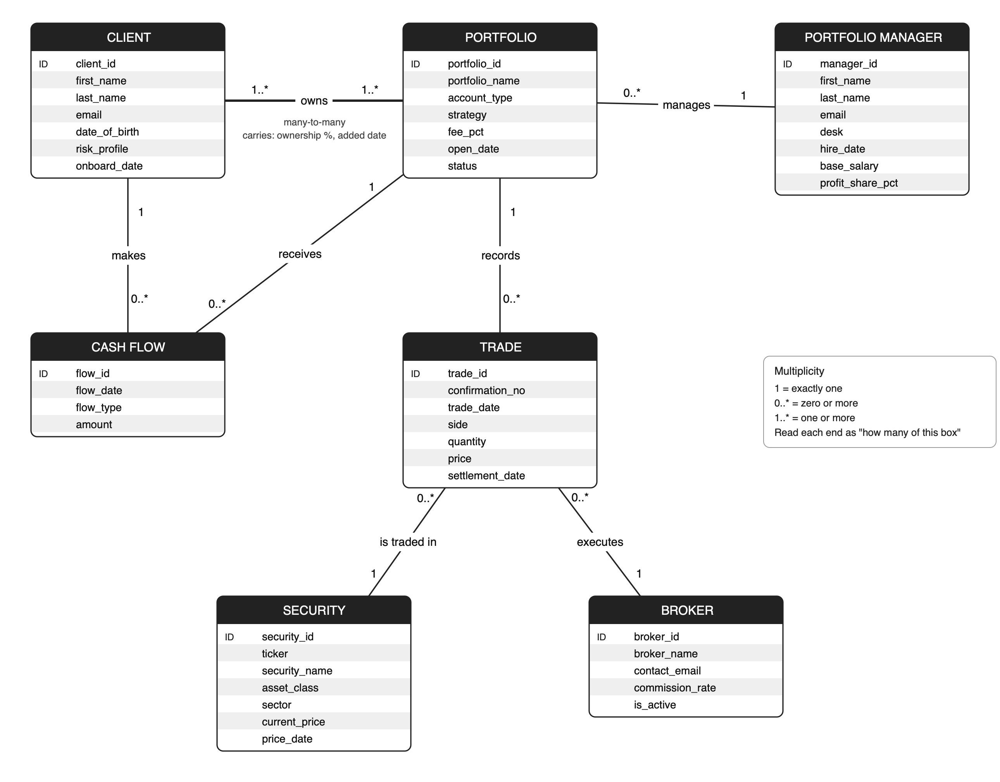
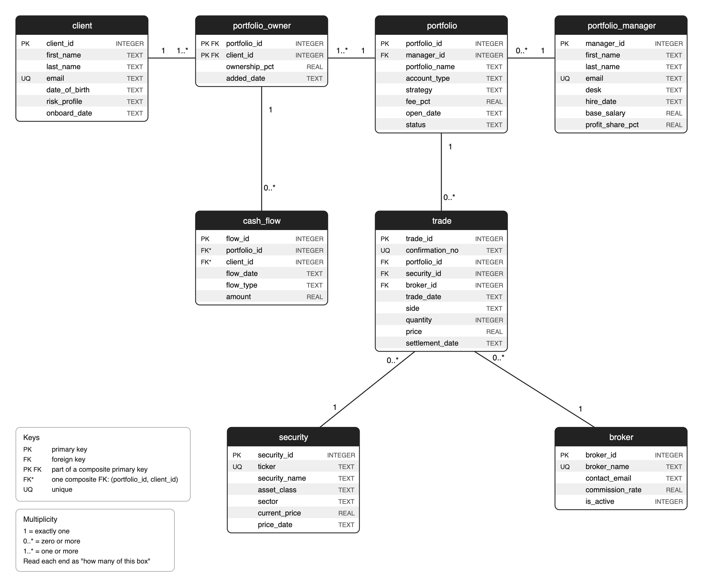

# Royal Point Capital: Designing and Implementing a Client Portfolio Management Database

**Reynaldo Garcia**  
Hult International Business School  
BAN-0301: Managing Structured Data with SQL  
Instructor: Todd Lombardo
October 2026

> Formatted version: [PDF](Royal_Point_Capital_A1.1_Report.pdf) · [Word](Royal_Point_Capital_A1.1_Report.docx). Logical data dictionary: [Excel workbook](../data_dictionary/Royal_Point_Capital_Logical_Data_Dictionary.xlsx).

This report documents the design and implementation of a relational database for one regional office of Royal Point Capital, an invented investment management firm. It covers the business case, business rules, conceptual and logical data models, data dictionaries and the SQL scripts that create, load and demonstrate the database.

## Overview

### Business Overview

Royal Point Capital is an invented, mid-to-large investment management firm with about 60 portfolio managers, 3,000 client portfolios and roughly $18 billion of assets under management. This database covers one regional office: 15 portfolio managers on three desks (Equity, Fixed Income and Multi-Asset) who invest client money in stocks, exchange-traded funds (ETFs) and bonds through outside brokers. The office has built its book since 2015 and today manages 537 active portfolios worth about $2.6 billion for 615 clients, many of them couples and families who own accounts jointly. The firm earns an annual management fee on each portfolio and pays its managers a base salary plus a share of the profits they generate for clients.

### Data Needs and Motivation

Today each investment desk logs client deposits, trades and broker confirmations in its own spreadsheet, and operations re-keys everything into a master file at the end of the day. Trades get booked to the wrong portfolio or entered twice, nobody can quickly say who legally owns a joint account or what share each owner holds, and rebuilding a client’s current holdings and returns takes hours. Because fees and manager bonuses are calculated by hand from these files, management cannot reliably see how much each portfolio earns the firm, what each manager is owed or what each broker charges in commissions. A single relational database replaces the spreadsheets with one record of owners, money in and out, and trades, from which holdings, value, profit, fees, pay and commissions are calculated on demand instead of being typed and re-typed.

#### Mission Statement:

The Royal Point Capital portfolio database gives the regional office one accurate, shared record of who owns each portfolio, every dollar clients deposit and withdraw, and every trade managers place through outside brokers, so the firm can value portfolios, pay its managers fairly and control trading costs from a single source of truth.

#### Mission Objectives:

1. Maintain complete records of clients and of every portfolio they own, including joint ownership and each owner’s share.
2. Record every deposit and withdrawal, and ensure that only an owner of a portfolio can move money into or out of it.
3. Record every trade exactly once, with its portfolio, security, broker, price and settlement date, using the broker’s confirmation number.
4. Report what each portfolio holds and what it is worth at today’s prices, including uninvested cash.
5. Measure profit since inception against the money clients invested, for each portfolio, client and manager.
6. Calculate each manager’s pay as base salary plus a profit share on positive client profit.
7. Estimate the firm’s annual fee revenue and compare it with what it pays its managers.
8. Track trading volume and commissions by broker to support broker selection and cost control.

### Business Rules

Relationship rules state both directions of each relationship (must or may; one or many). Constraint rules limit the values the data may take. Table 1 lists the rules; their numbers are used throughout the report, the data dictionary and the SQL scripts.

**Table 1**  
*Business Rules*

| # | Business rule | Type |
| --- | --- | --- |
| 1 | Each portfolio must be managed by exactly one portfolio manager; a portfolio manager may manage many portfolios. | Relationship |
| 2 | Each client must own one or more portfolios; each portfolio must be owned by one or more clients. (Enforced by the application when an account is opened; SQLite cannot block it with a column constraint.) | Relationship |
| 3a | Each trade must be for exactly one portfolio; a portfolio may have many trades. | Relationship |
| 3b | Each trade must be for exactly one security; a security may appear in many trades. | Relationship |
| 4 | Each trade must be executed by exactly one broker; a broker may execute many trades. | Relationship |
| 5a | Each cash flow must be made by exactly one client; a client may make many cash flows. | Relationship |
| 5b | Each cash flow must go into exactly one portfolio, and the client making it must be an owner of that portfolio; a portfolio may receive many cash flows. | Relationship |
| 6 | Each trade must have a unique broker confirmation number, so the same trade cannot be entered twice. | Constraint |
| 7 | A trade’s side must be “Buy” or “Sell”, and its quantity and price must be greater than zero. | Constraint |
| 8 | A client’s ownership percentage of a portfolio must be greater than 0 and no more than 100; the owners of a portfolio add up to 100%. | Constraint |
| 9 | A trade’s settlement date cannot be earlier than its trade date. | Constraint |
| 10 | A cash flow must be a “Deposit” or a “Withdrawal”, and its amount must be greater than zero. | Constraint |
| 11 | Fee, profit-share and commission rates are decimals between 0 and 1 (0.01 = 1%). | Constraint |
| 12 | Client and manager emails, security tickers and broker names are unique. | Constraint |
| 13 | Coded values come from fixed lists: risk profile (Conservative, Moderate, Aggressive), desk (Equity, Fixed Income, Multi-Asset), account type (Individual, Joint, IRA, Trust), strategy (Growth, Income, Balanced), portfolio status (Active, Closed) and asset class (Equity, ETF, Bond). | Constraint |
| 14 | A manager’s base salary and a security’s current price must be greater than zero; a manager earns a profit share only on positive client profit. | Constraint |

*Note.* Rule 2 is enforced by the application when an account is opened, because a column constraint cannot require a portfolio to have at least one owner.

### Assumptions

- Only today’s price of each security is stored, so all values are “as of” the price date (October 16, 2026).
- All amounts are in U.S. dollars; prices are per unit (per share or per bond); dividends and bond interest are not tracked.
- Fee, profit-share and commission rates are fixed for the period modeled.
- Profit is credited to a portfolio’s current manager; profit share is never paid on a loss.
- The sample data is simulated (see SQL Scripts), not taken from a real firm.

## Conceptual Data Model

The conceptual model (Figure 1) shows the things the business cares about in words a portfolio manager would recognize. It has no foreign keys and no junction tables: the client–portfolio relationship is drawn as a single many-to-many line, and the facts that belong to that pairing (ownership percentage and the date the owner was added) are noted on the line. Trade and cash flow are entities in their own right because each is a business event with its own facts.

**Figure 1**  
*Conceptual Data Model of the Royal Point Capital Regional Office*

*Note.* ID = identifier. Multiplicity: 1 = exactly one; 0..* = zero or more; 1..* = one or more. Each end of a line states how many of the entity at that end take part in the relationship.

Table 2 describes the function of each entity and the information it holds.

**Table 2**  
*Entities in the Conceptual Model*

| Entity | Function and information held |
| --- | --- |
| Client | A person who owns at least one portfolio. Holds contact details, date of birth, risk profile and the date the client joined the firm. |
| Portfolio | An investment account the office manages: its name, legal account type, investment strategy, agreed annual fee, opening date and whether it is still active. |
| Portfolio manager | An investment professional who runs portfolios. Holds the manager’s desk, hire date and pay terms (base salary and profit-share rate). |
| Cash flow | A single deposit into or withdrawal from a portfolio by one of its owners: date, direction and amount. |
| Trade | A single buy or sell of a security for a portfolio, executed by a broker: confirmation number, trade date, side, quantity, price and settlement date. |
| Security | A stock, ETF or bond on the firm’s approved list: ticker, name, asset class, sector and today’s market price. |
| Broker | An outside brokerage that executes trades: name, trading-desk contact, commission rate and whether the firm still uses it. |

## Conceptual Data Dictionary

Table 3 defines the business terms used in the database. Self-explanatory fields such as first name are not listed.

**Table 3**  
*Conceptual Data Dictionary*

| Term | Definition |
| --- | --- |
| Client ID | Unique number assigned to each client when onboarded. Never changes and is never reused, even if the client leaves. |
| Portfolio ID | Unique number (starting at 101) assigned to each investment account when it is opened. Never changes. |
| Manager ID | Unique number assigned to each portfolio manager at hire. |
| Portfolio | One investment account. A client can hold several (for example an individual account and an IRA). |
| Account type | Legal form of the account: Individual (one owner), Joint (two owners, usually spouses), IRA (individual retirement account, one owner) or Trust (a family trust with two or more owners). |
| Joint ownership / co-owned portfolio | A portfolio owned by more than one client. Each owner holds an ownership percentage. |
| Ownership percentage | An owner’s legal share of a portfolio, in percent. The owners of a portfolio add up to 100%. Set when the owner is added; not calculated from deposits. |
| Risk profile | How much investment risk the client accepts: Conservative, Moderate or Aggressive. Guides the portfolio strategy. |
| Strategy | The investment approach agreed with the client: Growth (mostly stocks), Balanced (stocks and bonds) or Income (mostly bonds). |
| Desk | The manager’s team: Equity, Fixed Income (bonds) or Multi-Asset. |
| Security | Any investment the firm can buy or sell. Identified by its ticker. |
| Ticker | Short exchange symbol for a stock or ETF (AAPL, VOO); for bonds, an internal identifier built from issuer, coupon and maturity (UST-4.25-30). |
| Asset class | Type of security: Equity (a company’s stock), ETF (an exchange-traded fund holding a basket of securities) or Bond (a loan to a government or company that pays interest). |
| Current price | The latest market price of one unit (one share or one bond) on the price date. Only today’s price is stored; there is no price history. |
| Broker | An outside firm that executes trades on the market for Royal Point and charges a commission. |
| Commission | Fee a broker charges on a trade: quantity × price × the broker’s commission rate. Calculated, not stored. |
| Trade | One purchase (Buy) or sale (Sell) of a security for a portfolio. |
| Confirmation number | Reference the broker issues for each executed trade (broker prefix + number, e.g. GS-10482). Unique, so a trade cannot be recorded twice. |
| Trade date / settlement date | The day the trade is agreed / the day cash and securities actually change hands. US settlement is one business day after the trade (T+1) since May 2024; earlier it was T+2 and, before September 2017, T+3. |
| Cash flow | Money a client moves into (Deposit) or out of (Withdrawal) a portfolio. |
| Net invested | Total deposits minus total withdrawals for a portfolio. |
| Holdings | The number of units of each security a portfolio owns: all buys minus all sells. Calculated, not stored. |
| Cash balance | Uninvested money in a portfolio: net invested − purchases + sale proceeds − commissions. |
| Portfolio value | Holdings × current price, plus the cash balance. |
| Profit (since inception) | Portfolio value minus net invested: what the portfolio has gained or lost since it opened. |
| Assets under management (AUM) | Total value of all active portfolios the office manages. |
| Management fee (fee_pct) | Annual fee the firm charges a portfolio as a percentage of its value, tiered by account size (0.60% to 1.25%). |
| Profit share (profit_share_pct) | Bonus rate paid to a manager on the positive profit of the portfolios they manage (0.25%–0.5%). Pay = base salary + rate × MAX(0, profit). |
| Status | Active (the firm still manages the portfolio) or Closed (all holdings sold and cash paid out to the owners). |

## Normalized (3NF) Logical Data Model

Figure 2 shows the final logical model in third normal form (3NF): eight tables and 55 columns, with primary and foreign keys labeled and multiplicities on every relationship.

**Figure 2**  
*Normalized (3NF) Logical Data Model*

*Note.* PK = primary key; FK = foreign key; PK FK = part of a composite primary key; FK* = one composite foreign key (portfolio_id, client_id) referencing portfolio_owner; UQ = unique. Types are SQLite storage types.

### From the Conceptual to the Logical Model

Each of the seven conceptual entities became a table with a numeric surrogate primary key that never changes (client_id, portfolio_id, manager_id, flow_id, trade_id, security_id and broker_id). Every one-to-many relationship became a foreign key on the “many” side: portfolio.manager_id for Rule 1, and trade.portfolio_id, trade.security_id and trade.broker_id for Rules 3a, 3b and 4. Because each of these rules says “must,” each foreign key is NOT NULL (Table 4).

The many-to-many relationship between client and portfolio cannot be stored with a single foreign key, so it was resolved into the associative table portfolio_owner. Its primary key is the pair (portfolio_id, client_id), and it carries the facts that belong to the pairing rather than to either side: ownership_pct (Elena Ruiz owns 50% of portfolio 101 and Daniel Ruiz owns the other 50%) and added_date. In the conceptual model, cash flow had two lines, one to client (Rule 5a) and one to portfolio (Rule 5b). In the logical model these merge into one composite foreign key from cash_flow to portfolio_owner, which enforces Rule 5b inside the database: a deposit by a client who does not own that portfolio is rejected.

Every column was then tested against the normal forms. For first normal form, multiple owners are separate rows in portfolio_owner rather than repeating owner_1 and owner_2 columns. For second normal form, ownership_pct and added_date depend on the whole composite key of portfolio_owner, not on the client or the portfolio alone. For third normal form, trade stores security_id and broker_id rather than a ticker or broker name, and it has no manager_id because the manager is reached through portfolio. Earlier drafts included fee_charge and manager_payment tables and a commission column on trade; they were removed because each is derived from stored rates (fee = value × fee_pct; commission = quantity × price × commission_rate; pay = base salary + profit_share_pct × profit), and storing them would create update anomalies. A currency column was dropped once all amounts were defined in U.S. dollars, and confirmation_no was added to prevent duplicate trades (Rule 6). The two prices that remain, trade.price and security.current_price, are different facts (what was paid then versus today’s market price), so neither duplicates the other.

**Table 4**  
*Foreign Keys in the Logical Model*

| Foreign key | References | Required | From rule |
| --- | --- | --- | --- |
| portfolio.manager_id | portfolio_manager | Yes | 1 |
| portfolio_owner.portfolio_id | portfolio | Yes | 2 |
| portfolio_owner.client_id | client | Yes | 2 |
| cash_flow.(portfolio_id, client_id) | portfolio_owner (composite) | Yes | 5a, 5b |
| trade.portfolio_id | portfolio | Yes | 3a |
| trade.security_id | security | Yes | 3b |
| trade.broker_id | broker | Yes | 4 |

### Why Normalize Before Building the Physical Database

Normalizing first means every fact about Royal Point lives in exactly one place. If a broker changes its commission rate, one row in broker changes and every commission recalculates; a stored commission or portfolio total would silently drift out of date. Normalization also lets the database enforce the business rules with keys and constraints instead of relying on people to type data consistently, which is precisely the problem the spreadsheets caused. Fixing the design at the logical stage is far cheaper than restructuring tables that already hold more than 22,000 rows.

## Logical Data Dictionary

The logical data dictionary is submitted as the Excel workbook *Royal_Point_Capital_Logical_Data_Dictionary.xlsx*. It has an Overview tab and one tab per table. Each tab lists every column with its Field Name, Type (the SQLite storage type: INTEGER, REAL or TEXT, with dates stored as YYYY-MM-DD text), Domain (accepted values or range, whether the field is required and its key role) and Example values taken from the sample data. Table 5 summarizes the tables.

**Table 5**  
*Tables in the Logical Data Dictionary*

| Table (workbook tab) | Columns | Sample rows |
| --- | --- | --- |
| client | 7 | 615 |
| portfolio_manager | 8 | 15 |
| security | 7 | 120 |
| broker | 5 | 6 |
| portfolio | 8 | 600 |
| trade | 10 | 15,405 |
| portfolio_owner | 4 | 840 |
| cash_flow | 6 | 4,552 |
| Total | 55 | 22,153 |

## SQL Scripts

The three scripts run in order in DB Browser for SQLite and pass the final test: on a brand-new database, 01_create.sql, then 02_load.sql, then 03_demonstrate.sql run with no errors. Each script starts with PRAGMA foreign_keys = ON.

### Create Script (01_create.sql)

The script drops and re-creates the eight tables in dependency order (tables with no foreign keys, then the tables that reference them, then the associative table and cash_flow), so it can be re-run. Every business rule that SQLite can enforce is written as a constraint: NOT NULL on required columns and foreign keys; PRIMARY KEY, including the composite key on portfolio_owner; FOREIGN KEY, including the composite key from cash_flow to portfolio_owner; UNIQUE on emails, ticker, broker name and confirmation number; and CHECK on coded lists, positive amounts, rates between 0 and 1, ownership between 0 and 100 and settlement dates.

### Load Script (02_load.sql)

The script loads 22,153 rows, at least six in every table, representing one regional office since 2015 (Table 5). The data was simulated with a Python script (generate_royal_point_data.py, fixed random seed) so that every row obeys the rules: no sale exceeds the shares held, cash never goes negative, each portfolio’s owners add up to 100%, trades fall on weekdays after the portfolio opened and settlement follows the historical U.S. T+3, T+2 and T+1 rules. Prices follow a shared market factor and an interest-rate factor, so returns are realistic: the S&P 500 ETF rises about 134% over the period while the core bond ETF falls about 7%. Deliberate story rows make the queries meaningful: a jointly owned portfolio (101), a new manager with no portfolios, an inactive broker with no trades, a security that was never traded, 63 closed portfolios, three funded portfolios with no trades yet and a manager whose clients lost money.

### Demonstration Script (03_demonstrate.sql)

**Part A (build checks)** confirms eight tables and 55 columns, the rows in each table (the smallest is broker, with six), that foreign keys are switched on and that there are no orphan rows.

**Part B (business questions)** creates two views that compute holdings and portfolio value once from stored facts, then answers the three questions from the business need:

- **Q1, portfolio value and profit:** 537 active portfolios with holdings, cash, value and return since opening; a five-way join lists the seven holdings of portfolio 101 (Elena and Daniel Ruiz).
- **Q2, manager pay:** Kevin Brandt generated the most client profit ($171.5 million; total pay $921,000). Gabriela Santos, a new hire, appears through the LEFT JOIN at base salary only, and Yara Haddad’s clients lost $6.8 million, so her profit share is $0.
- **Q3, fees, pay and brokers:** $2.62 billion under management earns about $21.2 million a year in fees against $6.8 million of manager pay (32% of fee revenue). Harbor & Vine Securities charges the most commission ($700,800) despite fewer trades than Granite Street Securities because its rate is higher; the inactive broker shows zero.

**Part C (rule tests)** contains statements that each break one rule. They are kept commented out; run on its own, each fails with the expected error and leaves no row behind (Table 6).

**Table 6**  
*Rule Tests in Part C*

| Test | Rule | Bad statement | Error returned by SQLite |
| --- | --- | --- | --- |
| C1 | 1 | Portfolio with manager_id NULL | NOT NULL constraint failed: portfolio.manager_id |
| C2 | 3b | Trade for security 999 (does not exist) | FOREIGN KEY constraint failed |
| C3 | 5b | Client 7 deposits into portfolio 101 (not an owner) | FOREIGN KEY constraint failed |
| C4 | 7 | Trade with side ‘Hold’ | CHECK constraint failed: side IN ('Buy','Sell') |
| C5 | 8 | Ownership of 150% | CHECK constraint failed: ownership_pct > 0 AND ownership_pct <= 100 |
| C6 | 9 | Settlement before the trade date | CHECK constraint failed: settlement_date >= trade_date |
| C7 | 6 | Second trade with confirmation GS-10482 | UNIQUE constraint failed: trade.confirmation_no |

**Part D (filtered samples)** runs one WHERE-filtered query against each table to show how it is used day to day (Table 7).

**Table 7**  
*Filtered Sample From Each Table in Part D*

| Query | Table | Filter | Rows |
| --- | --- | --- | --- |
| D1 | client | Aggressive-risk clients onboarded since 2024 | 42 |
| D2 | portfolio_manager | Equity-desk managers hired before 2020 | 4 |
| D3 | security | The approved bond list | 10 |
| D4 | broker | Active brokers charging under 0.06% | 3 |
| D5 | portfolio | Joint, Growth portfolios opened since 2024 | 15 |
| D6 | trade | Sells over $1M placed in 2026 | 28 |
| D7 | portfolio_owner | Minority owners (under 50%) | 122 |
| D8 | cash_flow | Withdrawals of $1M+ in 2026 | 8 |

## Disclosure of AI Use

Consistent with the course policy, Claude, an AI assistant (Anthropic, 2026), was used during this project to discuss the case and business rules, draft and edit text, check the design against the assignment guide, generate the simulated sample data with a Python script, draw the entity–relationship diagrams, and draft and test the SQL scripts. All design decisions, outputs and results were reviewed by the author.

## References

Anthropic. (2026). *Claude* (Opus 5.5 version) [Large language model]. https://claude.ai
